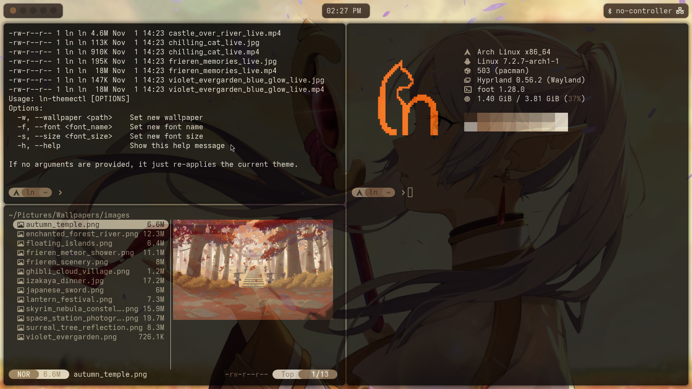
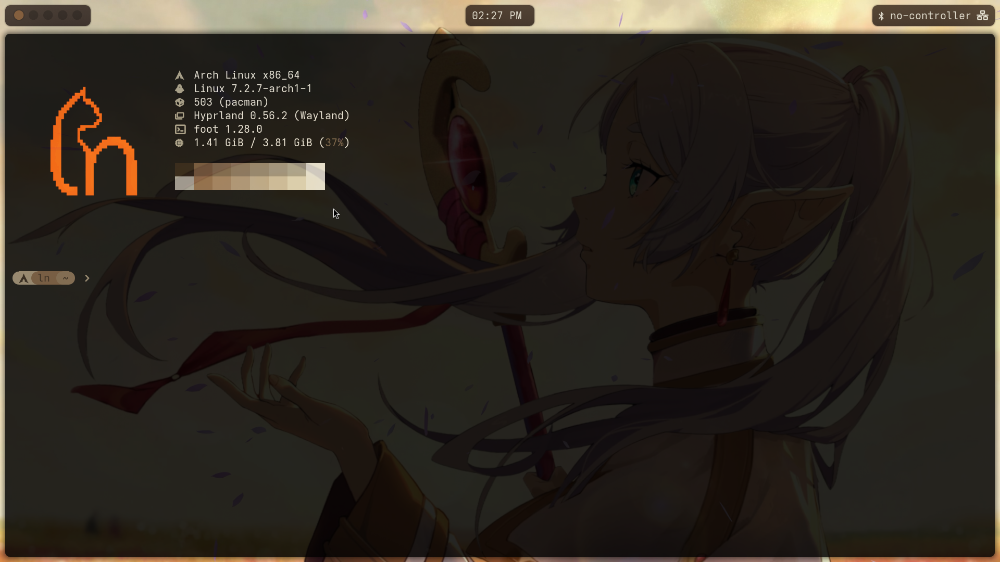
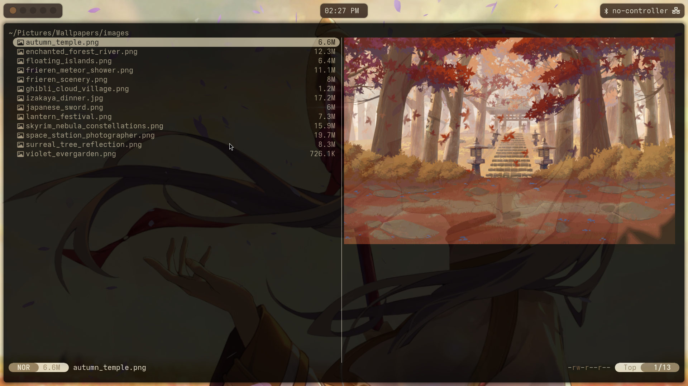
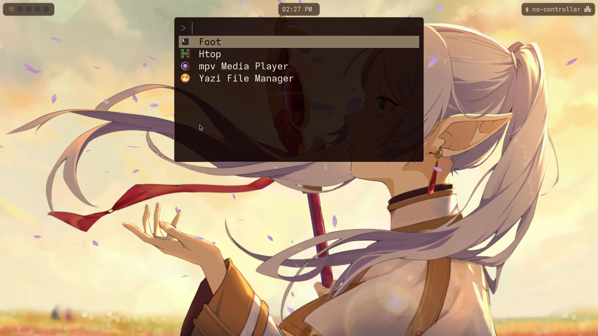

<div align="center">
  <!-- Replace with your own banner or a beautiful screenshot snippet -->
  
  
  # ❄️ Minimal Hyprland Dotfiles
  
  *Aesthetic, blazing-fast, and minimal configuration for Wayland.*
  
  
  
  
  
  
</div>

## 📖 Introduction

Welcome to my personal dotfiles. This repository contains the configuration files for my daily driver setup, built around **Hyprland** on Wayland. 

The core philosophy here is **uncompromising minimalism and performance combined with eye-candy dynamic theming**. By utilizing tools like Foot, native Waybar modules, and Wallust for blazing-fast dynamic colors, the setup is designed to get out of your way and let you focus, while keeping a unified, beautiful aesthetic.

## 📦 What's Included

| Area | Contents |
| --- | --- |
| **Hyprland** | Lua config (`hyprland.lua`, `autostart`, `env`, `input`, `keybindings`, `misc`, `monitors`, `style`, `window_workspace`), plus `hypridle`, `hyprpaper` and a `hyprlock` template |
| **Waybar** | `config`, a `style.css` template, helper scripts, and four switchable themes: `default`, `experimental`, `line`, `zen` (with preview images in `assets/`) |
| **Terminal & launcher** | [Foot](https://codeberg.org/dnkl/foot) and [Fuzzel](https://codeberg.org/dnkl/fuzzel) templates |
| **Notifications** | [Mako](https://github.com/emersion/mako), generated from a Wallust template |
| **Files** | [Yazi](https://github.com/sxyazi/yazi) (`yazi.toml` + generated `theme.toml`) |
| **Theming** | [Wallust](https://codeberg.org/explosion-mental/wallust) config and templates (foot, hyprland, waybar, fuzzel, mako, yazi, shell colors) |
| **Shell & tools** | `.bashrc`, [Starship](https://starship.rs/), Nushell (`env.nu`, `config.nu`), Fastfetch, htop, global git ignore, `mimeapps.list` |
| **Editor** | [Zed](https://zed.dev/) `settings.json` and `keymap.json` |
| **Scripts** (`~/.local/bin`) | `ln-themectl`, `ln-monitorctl`, `ln-brightnessctl`, `ln-playerctl`, `ln-wpctl`, `ln-askpass` (fuzzel-based `SSH_ASKPASS`) |
| **Live wallpapers** | `mpvpaper` and `mpvpaper-holder` binaries for video wallpapers |
| **Assets** | `wallpapers/` (`images/`, `videos/` with jpg thumbnails, plus the default Frieren live wallpaper) and `logo/ln_pixal.png` |

### 🎨 Theming flow

`wallust` extracts a palette from the current wallpaper (the thumbnail for videos) and renders the files in `.config/wallust/templates/` into `~/.cache/wallust/`. `ln-themectl` then fills the `*.template` files with the font settings from `env.lua`, writes the final configs, and restarts waybar, the wallpaper daemon (`hyprpaper` or `mpvpaper`) and mako.

```bash
ln-themectl                      # re-apply the current theme
ln-themectl -w <image-or-video>  # set a new wallpaper
ln-themectl -f "<font>" -s 16    # change font name / size
```

### 🚫 Generated files (not tracked)

These are produced by `ln-themectl` and ignored by git, so do not edit them by hand:

- `~/.config/foot/foot.ini`
- `~/.config/fuzzel/fuzzel.ini`
- `~/.config/waybar/style.css`
- `~/.config/hypr/hyprlock.conf`
- `~/.config/mako/config`

## 🖼️ Showcase

<details>
<summary><b>Click to expand screenshots</b></summary>

| Clean Desktop | Busy Workspace |
| :---: | :---: |
|  |  |

| Terminal (Foot) | File Manager (Yazi) |
| :---: | :---: |
|  |  |

| Launcher (Fuzzel) |
| :---: |
|  |

</details>

## ⚙️ System Specifications / Verdicts

| Component | Choice | Verdict / Notes |
| --- | --- | --- |
| **Machine** | Laptop, Intel Core Ultra 7 258V (8 cores) | Integrated Intel Arc 130V/140V graphics, 32 GB RAM. |
| **OS** | [Arch Linux](https://archlinux.org/) | Rolling release, kernel 7.2.11-arch1-1. |
| **Display** | Internal 2880x1800@120 (scale 2.25), external 2560x1440@120 (as set in `monitors.lua`) | `ln-monitorctl ini` disables the laptop panel when an external monitor is attached. |
| **WM** | [Hyprland](https://hyprland.org/) 0.57 | Lua config, snappy custom bezier curves and VFR enabled for battery life. |
| **Terminal** | [Foot](https://codeberg.org/dnkl/foot) | Lightweight Wayland-native terminal, themed via Wallust. |
| **Shell** | Bash + [Starship](https://starship.rs/) | Minimal preset with strict 500ms command timeouts; Nushell config also tracked. |
| **Theming** | [Wallust](https://codeberg.org/explosion-mental/wallust) | Replaced Pywal; dynamic colors deployed via `ln-themectl`. |
| **Bar** | [Waybar](https://github.com/Alexays/Waybar) | Purely native modules (no heavy custom shell scripts). |
| **Launcher** | [Fuzzel](https://codeberg.org/dnkl/fuzzel) | Wayland-native, extremely fast application launcher. |
| **Files** | [Yazi](https://github.com/sxyazi/yazi) | Terminal file manager with `sixel` image previews in Foot. |

## 🛠️ Installation & Guidelines

> [!WARNING]
> **Do not install these dotfiles blindly on your main machine.** Configurations are highly personalized and running automated install scripts on a live host can cause unexpected behavior.

### Live Deployment

If you are absolutely ready to apply these configurations to your live host, we use a custom installation script rather than symlink managers like GNU Stow.

> [!NOTE]
> The repository is large (~185MB+ to clone) because it ships the wallpapers and live-wallpaper videos.

1. **Clone the repository:**
   ```bash
   git clone https://github.com/yourusername/dotfiles.git ~/git/dotfiles
   cd ~/git/dotfiles
   ```

2. **Execute the installation script:**
   *Note: Ensure you read through the script first to understand what files it will touch.*
   ```bash
   ./install.sh
   ```

### What `install.sh` Does

- Refuses to run as root and warns if the system is not Arch Linux.
- Installs the core packages with `pacman`, and `wallust` from the AUR (via `paru`/`yay`, offering to bootstrap `yay-bin`, with a prebuilt-binary fallback).
- **Copies** (no symlinks) every top-level item of `.config/` into `~/.config/`, every script in `.local/bin/` into `~/.local/bin/`, and `.bashrc` into `~/`.
- Deploys `wallpapers/` to `~/Pictures/Wallpapers/` (subfolders like `images/` and `videos/` as whole folders) and `logo/` to `~/Pictures/Logo/`.
- Anything it replaces is first moved to `~/.config/dotfiles_backup_<timestamp>/`.
- Refreshes the font cache and runs `ln-themectl` at the end to generate the themed configs.
- Logs everything to `install.log` in the repository (git-ignored).

> [!WARNING]
> Whole `~/.config/<dir>` folders are replaced, not merged. Anything in them that is not in this repository (for example Nushell's `history.txt` or Zed's `themes/`) ends up in the backup folder, and you have to move it back by hand.

## 📜 License

These dotfiles are licensed under the [GNU General Public License v3.0](LICENSE). Feel free to use, modify, and distribute them as you see fit to build your perfect workspace.

<div align="center">
  <i>If you found this repository helpful, consider leaving a ⭐!</i>
</div>
